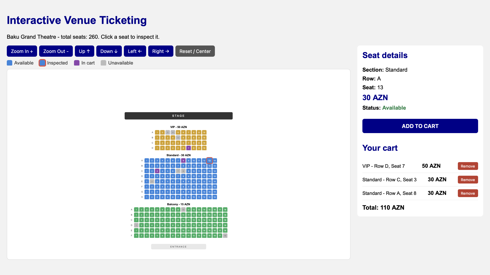

# Interactive Venue Ticketing System

A front-end ticket selection website for a theatre, built with HTML, CSS and JavaScript for the Web & Mobile I course.

## Venue

**Baku Grand Theatre** (auditorium / theatre type)

| Section | Rows | Seats per row | Seats | Price |
|---------|------|---------------|-------|-------|
| VIP | 4 | 10 | 40 | 50 AZN |
| Standard | 8 | 14 | 112 | 30 AZN |
| Balcony | 6 | 18 | 108 | 15 AZN |

Total: 260 seats. Some seats are marked as unavailable (already sold).

## Features

- Venue map generated from JavaScript data (no copied seat elements in HTML)
- Every seat is a `<button>` element
- Clicking a seat only inspects it: details and price are shown in a side panel
- Seat states: available, inspected, in cart, unavailable
- Explicit ADD TO CART button; duplicate tickets are prevented
- Cart with ticket prices, total price and remove buttons
- Map and cart stay synchronized (removing a ticket updates the seat)
- Cart saved in localStorage and restored after refresh
- Map controls: Zoom In, Zoom Out, Up, Down, Left, Right, Reset / Center
- Responsive layout for desktop and mobile widths
- Bonus: mouse wheel zoom and click-drag panning (buttons still work)

## How to run

1. Download or clone the repository.
2. Open `index.html` in a web browser.

No installation or server is required.

## Project structure

- `index.html` - page structure
- `style.css` - styles and responsive layout
- `data.js` - venue data (sections, rows, prices, unavailable seats)
- `script.js` - seat generation, inspection, cart, storage and map navigation

## How it works

- `data.js` describes the venue as an object with sections. Each section has rows, seats per row, a price and a color.
- `script.js` loops over the sections, rows and seats and creates one button for every seat.
- The cart is an array of seat ids. It is saved to localStorage after every change and restored when the page loads. Saved ids are checked so that unavailable or unknown seats are ignored.

## Known limitations

- Drag panning works with a mouse. On touch screens, use the navigation buttons.
- There is no backend, so seat availability is not shared between users.